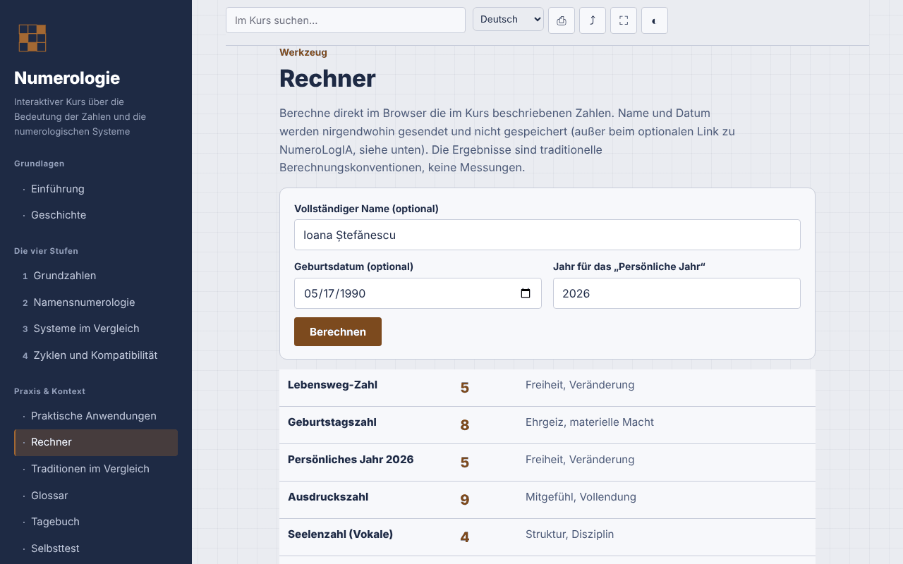

# Numerologie — interaktiver Kurs

[English](README.md) · [Română](README.ro.md) · [Français](README.fr.md) · [Italiano](README.it.md) · [Español](README.es.md) · [Português](README.pt.md) · **Deutsch** · [Magyar](README.hu.md)

**Version:** 1.3.3 · **Zuletzt aktualisiert:** 2026-10-22

Oberflächensprachen: **Română, English, Français, Italiano, Español, Português (PT), Deutsch, Magyar**

Ein Kurs auf Rumänisch über Numerologie (pythagoreisches, chaldäisches und kabbalistisches System), mit lokalem Rechner, in einer einzigen HTML-Datei.

**Online-Anwendung:** https://chiuta.github.io/Numerologie/

## Was es ist

Ein interaktiver Kurs über die Numerologie als symbolische Tradition: Geschichte, vier Stufen (Grundzahlen, Namensnumerologie, Systeme im Vergleich, Zyklen und Kompatibilitäten), Übungen, vergleichender Anhang, Glossar, Tagebuch, Selbsttest und ein Rechner, der die Regeln aus dem Kurs anwendet. Die Numerologie wird als Tradition und Unterhaltung dargestellt, ohne wissenschaftliche Bestätigung.

## Funktionen

Abschnitte: Einführung, Geschichte, die vier Stufen, Praktische Anwendungen, Rechner, Traditionen im Vergleich, Glossar, Tagebuch, Selbsttest.

Im Code geprüft und im Browser getestet:
- Lokaler Rechner: Lebenswegzahl, Persönliches Jahr, Ausdruckszahl, Herzenswunschzahl (Vokale) und Persönlichkeitszahl (Konsonanten). Pythagoreische A–Z-Tabelle (A,J,S=1 … I,R=9), Meisterzahlen 11/22/33 bleiben bei der Reduktion von Datum und Name erhalten, Persönliches Jahr wird auf 1–9 reduziert. Rumänische Diakritika werden wie der Grundbuchstabe berechnet (ă, â → A; î → I; ș, ț → S, T; und die Varianten mit Cedille); Y ist ein Konsonant. Der Rechner zeigt die verwendeten Buchstaben und Werte an und weist darauf hin, wenn die Methode mit getrennter Reduktion von Tag/Monat/Jahr ein anderes Ergebnis liefert.
- Der Rechner ergänzt die Geburtstagszahl (der reduzierte Tag, Stopp bei 11, 22) und die Reifezahl (Lebensweg + Ausdruck, Stopp bei 11, 22, 33) — traditionelle Konventionen, keine Messungen; die Schaltflächen „Ergebnisse kopieren“ und „Zum Tagebuch hinzufügen“ (nur die numerischen Ergebnisse, ohne Name oder Datum) bleiben auf der Seite.
- Der Rechner ergänzt den Wert des Namens im chaldäischen System (traditionelle, lautbasierte Tabelle, ohne die Ziffer 9; zusammengesetzte Summe → reduziert), angezeigt neben dem pythagoreischen Ausdruck, mit detaillierten Buchstaben.
- Automatischer Dunkelmodus (`prefers-color-scheme: dark`; beim Drucken wird zur hellen Palette zurückgekehrt).
- Suche unabhängig von diakritischen Zeichen; Direktlink zu Abschnitten (`#calculator`, `#quiz`).
- Tagebuch als `.txt` herunterladbar; Quiz mit 10 Fragen und gemischter Antwortreihenfolge (Fisher–Yates).
- Drucken (aktueller Abschnitt), Link teilen/kopieren, Vollbild, Bildschirm aktiv halten (soweit der Browser sie unterstützt).

## Bedienungsanleitung

1. Wähle einen Abschnitt im Menü (auf dem Handy ☰ antippen).
2. Gehe die Stufen und Übungen durch.
3. Gib im „Rechner“ den Namen und/oder das Geburtsdatum ein (Datumsformat aus der Auswahl oder `Tag.Monat.Jahr`), prüfe das Jahr für das Persönliche Jahr und drücke „Berechnen“.
4. Notiere deine Beobachtungen im „Tagebuch“ und lade sie vor dem Schließen der Seite als `.txt` herunter.
5. Bearbeite den „Selbsttest“; „Test wiederholen“ mischt die Antworten.

## Datenschutz und Netzwerk

- Speicherung: Es werden weder `localStorage`, `sessionStorage`, IndexedDB noch Cookies verwendet. Name und Datum, die im Rechner eingegeben werden, bleiben auf der Seite und werden weder gesendet noch gespeichert.
- Netzwerk: keine externen Anfragen (keine Schriftarten, Skripte, Bilder, Analysedienste). Die CSP `default-src 'none'` blockiert Verbindungen. Es gibt keine externen Links.
- Berechtigungen: Beim Laden wird nichts abgefragt; beim Drücken von Schaltflächen können Vollbild, Wake Lock, Zwischenablage (Link kopieren) und Vibration auf dem Handy während des Quiz verwendet werden.

## Grenzen und Hinweise

- Die Numerologie ist eine symbolische Tradition, die zur Reflexion und Unterhaltung dient. Es gibt keine wissenschaftlichen Belege dafür, dass Name oder Geburtsdatum Charakter, Beziehungen oder Schicksal bestimmen.
- Der Inhalt ersetzt keine medizinische, psychologische, rechtliche oder finanzielle Beratung; triff keine Entscheidungen zu Gesundheit, Geld, Beziehungen oder Beschäftigung auf Grundlage einer Berechnung.
- Es gibt keine einheitliche Berechnungskonvention; andere Quellen können andere Ergebnisse liefern (Behandlung des Y, der Diakritika, Reihenfolge der Reduktion).
- Der babylonische Ursprung des chaldäischen Systems und die direkte Verbindung des Pythagoras zum modernen System sind traditionelle Zuschreibungen, keine gesicherten historischen Tatsachen; die Erwähnung rumänischer Praktizierender ist informativ, ohne Bewertung.

## Lokal / offline ausführen

Lade `index.html` herunter und öffne die Datei im Browser; sie funktioniert ohne Internet.

## Lizenz

MIT — siehe Datei LICENSE.

## Verlauf / Changelog

### 1.3.3 — 2026-10-22
- fff-kit 1.1.2: PBKDF2 mit 600.000 Iterationen, Schutz vor Clickjacking

### 1.3.2 — 2026-10-22
- Die confirm()/prompt()-Fenster des Browsers durch eigene, in die 8 Sprachen übersetzte Dialoge ersetzt (Tagebuch leeren, manuelles Kopieren von Link und Ergebnissen).

### 1.2.0 — 2026-10-19
- Optionaler Link „Erweiterte Analyse in NumeroLogIA“ (neuer Tab, `rel="noopener noreferrer"`), nur bei ausdrücklichem Klick: Name und Geburtsdatum erscheinen im `#`-Fragment der NumeroLogIA-Adresse (sie werden nicht über das Netzwerk gesendet, bleiben aber im Browserverlauf); sichtbarer Hinweis neben dem Link. Die Aussage „werden nirgendwohin gesendet“ wurde entsprechend angepasst.

### 1.1.0 — 2026-10-14
- Datensicherung und Datenkennzeichnung (fff-kit).

### 1.0.0 — 2026-10-12
- Die Version und das Datum der letzten Aktualisierung werden in der Anwendung angezeigt (Fußzeile).

### 11. Oktober 2026 (Runde 7)
- Neu: Dunkelmodus (die Palette verwendete `--ink` auch als Hintergrund; feste Hintergründe wurden auf `--navy` umgestellt, und der Druck erzwingt die helle Palette); mit axe-core auf allen 13 Abschnitten getestet, in hellem und dunklem Schema, bei 1280 und 360 px.
- Neu: der chaldäische Wert des Namens im Rechner.
- Behoben: Überschriftenreihenfolge in „Praktische Anwendungen“ (h2 → h4; axe `heading-order`).

### 11. Oktober 2026 (Runde 6)
- Sicherheit: CSP `script-src` per SHA-256-Hash des einzigen Skripts, ohne `'unsafe-inline'` für Skripte.
- Hinzugefügt: Geburtstagszahl und Reifezahl im Rechner; Ergebnisse kopieren und zum Tagebuch hinzufügen.

### 11. Oktober 2026
- Behoben: Die Seite hat jetzt eine Überschrift der Ebene 1 im Hauptbereich (auf dem Handy ist das Seitenmenü ausgeblendet, daher zählte die Überschrift im Menü nicht mehr); die Überschrift im Menü ist ein dekoratives Element mit demselben Aussehen. 0 axe-core-Verstöße bei 1280 und 360 px.
- Geprüft: Der Rechner verwendet das dynamisch berechnete aktuelle Jahr (Persönliches Jahr 2026 am 11.10.2026).

## Autor

Alexio — Alexandru-Ionuț Chiuță, Kontakt: alexio@trom.tf

## Zusammenfassung

Ein Offline-Kurs in einer einzigen Datei, auf Rumänisch, über Numerologie (pythagoreische, chaldäische, kabbalistische Traditionen) mit einem lokalen Rechner für Lebensweg, Persönliches Jahr und Namenszahlen (Ausdruck, Herzenswunsch, Persönlichkeit), der Meisterzahlen und rumänische Diakritika berücksichtigt. Keine Speicherung, keine externen Anfragen, keine Telemetrie. Dargestellt als Tradition und Unterhaltung ohne wissenschaftliche Bestätigung; ersetzt keine fachliche Beratung. Lizenz: MIT (siehe Datei LICENSE).
