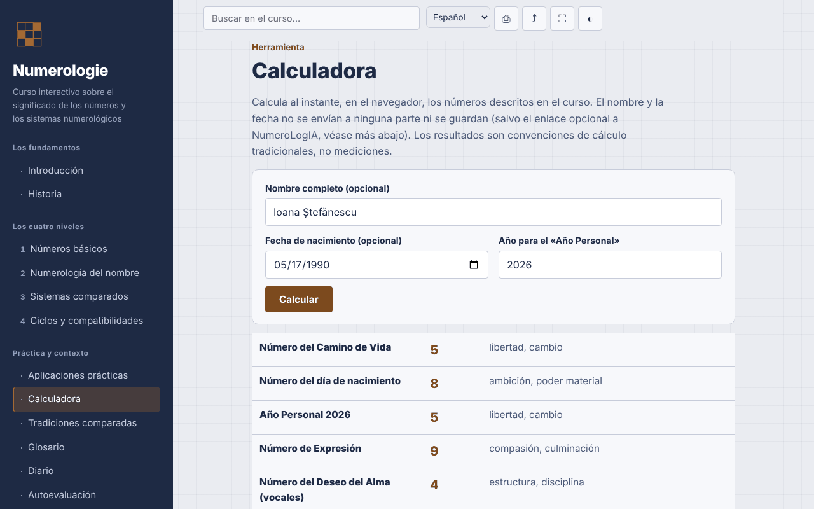

# Numerología — curso interactivo

[English](README.md) · [Română](README.ro.md) · [Français](README.fr.md) · [Italiano](README.it.md) · **Español** · [Português](README.pt.md) · [Deutsch](README.de.md) · [Magyar](README.hu.md)

**Versión:** 1.3.6 · **Última actualización:** 2026-10-23

Idiomas de la interfaz: **Română, English, Français, Italiano, Español, Português (PT), Deutsch, Magyar**

Curso en rumano sobre numerología (sistemas pitagórico, caldeo y cabalístico), con calculadora local, en un único archivo HTML.

**Aplicación en línea:** https://chiuta.github.io/Numerologie/

## Qué es

Un curso interactivo sobre numerología como tradición simbólica: historia, cuatro niveles (números básicos, numerología del nombre, sistemas comparados, ciclos y compatibilidades), ejercicios, anexo comparativo, glosario, diario, autoevaluación y una calculadora que aplica las reglas del curso. La numerología se presenta como tradición y entretenimiento, sin validación científica.

## Funciones

Secciones: Introducción, Historia, los cuatro niveles, Aplicaciones prácticas, Calculadora, Tradiciones comparadas, Glosario, Diario, Autoevaluación.

Verificado en el código y probado en el navegador:
- Calculadora local: Número del Camino de Vida, Año Personal, Número de Expresión, del Deseo Interior (vocales) y de la Personalidad (consonantes). Tabla pitagórica A–Z (A,J,S=1 … I,R=9), números maestros 11/22/33 conservados al reducir la fecha y el nombre, Año Personal reducido a 1–9. Los signos diacríticos rumanos se calculan como la letra base (ă, â → A; î → I; ș, ț → S, T; y las variantes con cedilla); la Y es consonante. La calculadora muestra las letras y los valores utilizados y avisa cuando el método con reducción separada del día/mes/año da un resultado distinto.
- La calculadora añade el Número del Día de Nacimiento (el día reducido, con parada en 11, 22) y el Número de Madurez (Camino de Vida + Expresión, con parada en 11, 22, 33) — convenciones tradicionales, no mediciones; los botones «Copiar resultados» y «Añadir al diario» (solo los resultados numéricos, sin nombre ni fecha) permanecen en la página.
- La calculadora añade el valor del nombre en el sistema caldeo (tabla tradicional basada en el sonido, sin la cifra 9; total compuesto → reducido), mostrado junto a la Expresión pitagórica, con las letras detalladas.
- Modo oscuro automático (`prefers-color-scheme: dark`; al imprimir se vuelve a la paleta clara).
- Búsqueda insensible a los signos diacríticos; enlace directo a las secciones (`#calculator`, `#quiz`).
- Diario descargable como `.txt`; test de 10 preguntas con el orden de las respuestas mezclado (Fisher–Yates).
- Impresión (sección actual), compartir/copiar el enlace, pantalla completa, mantener la pantalla activa (donde el navegador lo admita).

## Manual de uso

1. Elige una sección en el menú (en el móvil, pulsa ☰).
2. Recorre los niveles y los ejercicios.
3. En «Calculadora» escribe el nombre y/o la fecha de nacimiento (formato de fecha del selector o `día.mes.año`), comprueba el año para el Año Personal y pulsa «Calcular».
4. Anota tus observaciones en el «Diario» y descárgalas como `.txt` antes de cerrar la página.
5. Resuelve la «Autoevaluación»; «Repetir el test» mezcla las respuestas.

## Privacidad y red

- Almacenamiento: no usa `localStorage`, `sessionStorage`, IndexedDB ni cookies. El nombre y la fecha introducidos en la calculadora permanecen en la página y no se envían ni se guardan.
- Red: ninguna solicitud externa (sin fuentes, scripts, imágenes ni analíticas). La CSP `default-src 'none'` bloquea las conexiones. No hay enlaces externos.
- Permisos: no pide nada al cargar; al pulsar los botones pueden usarse pantalla completa, wake lock, portapapeles (copia del enlace) y vibración en el móvil durante el test.

## Límites y advertencias

- La numerología es una tradición simbólica, usada para la reflexión y el entretenimiento. No hay pruebas científicas de que el nombre o la fecha de nacimiento determinen el carácter, las relaciones o el destino.
- El contenido no sustituye el consejo médico, psicológico, jurídico o financiero; no tomes decisiones sobre salud, dinero, relaciones o empleo basándote en un cálculo.
- No existe una convención de cálculo única; otras fuentes pueden dar resultados distintos (tratamiento de la Y, de los signos diacríticos, orden de reducción).
- El origen babilónico del sistema caldeo y la conexión directa de Pitágoras con el sistema moderno son atribuciones tradicionales, no hechos históricos confirmados; la mención de profesionales rumanos es informativa, sin valoración.

## Ejecución local / sin conexión

Descarga `index.html` y ábrelo en el navegador; funciona sin internet.

## Licencia

MIT — consulta el archivo LICENSE.

## Historial / Changelog

### 1.3.4 — 2026-10-22

fff-kit 1.1.4: objetivos táctiles y tamaño mínimo de texto; objetivos táctiles y texto corregidos.

### 1.3.3 — 2026-10-22
- fff-kit 1.1.2: PBKDF2 con 600.000 iteraciones, protección anti-clickjacking

### 1.3.2 — 2026-10-22
- Los cuadros confirm()/prompt() del navegador sustituidos por diálogos propios traducidos a los 8 idiomas (vaciar el diario, copia manual del enlace y de los resultados).

### 1.2.0 — 2026-10-19
- Enlace opcional «Análisis ampliado en NumeroLogIA» (pestaña nueva, `rel="noopener noreferrer"`), solo con un clic explícito: el nombre y la fecha de nacimiento aparecen en el fragmento `#` de la dirección de NumeroLogIA (no se envían por la red, pero quedan en el historial del navegador); nota visible junto al enlace. La afirmación «no se envían a ninguna parte» se ha modificado en consecuencia.

### 1.1.0 — 2026-10-14
- Copia de seguridad y etiquetado de datos (fff-kit).

### 1.0.0 — 2026-10-12
- La versión y la fecha de la última actualización se muestran en la aplicación (pie de página).

### 11 de octubre de 2026 (ronda 7)
- Nuevo: modo oscuro (la paleta usaba `--ink` también como fondo; los fondos fijos pasaron a `--navy` y la impresión fuerza la paleta clara); probado con axe-core en las 13 secciones, en esquemas claro y oscuro, a 1280 y 360 px.
- Nuevo: el valor caldeo del nombre en la calculadora.
- Corregido: orden de los títulos en «Aplicaciones prácticas» (h2 → h4; axe `heading-order`).

### 11 de octubre de 2026 (ronda 6)
- Seguridad: CSP `script-src` mediante hash sha256 del único script, sin `'unsafe-inline'` para scripts.
- Añadido: Número del Día de Nacimiento y Número de Madurez en la calculadora; copia de resultados y adición al Diario.

### 11 de octubre de 2026
- Corregido: la página tiene ahora un título de nivel 1 en el área principal (en el móvil el menú lateral está oculto, por lo que el título del menú dejaba de contar); el título del menú es un elemento decorativo con el mismo aspecto. 0 infracciones de axe-core a 1280 y 360 px.
- Verificado: la calculadora usa el año actual calculado dinámicamente (Año Personal 2026 el 11.10.2026).

## Autor

Alexio — Alexandru-Ionuț Chiuță, contacto: alexio@trom.tf

## Resumen

Un curso de un solo archivo, sin conexión, en rumano, sobre numerología (tradiciones pitagórica, caldea, cabalística) con una calculadora local para el camino de vida, el año personal y los números del nombre (expresión, deseo interior, personalidad), que gestiona los números maestros y los signos diacríticos rumanos. Sin almacenamiento, sin solicitudes externas, sin telemetría. Presentado como tradición y entretenimiento sin validación científica; no sustituye el asesoramiento profesional. Licencia: MIT (consulta el archivo LICENSE).
