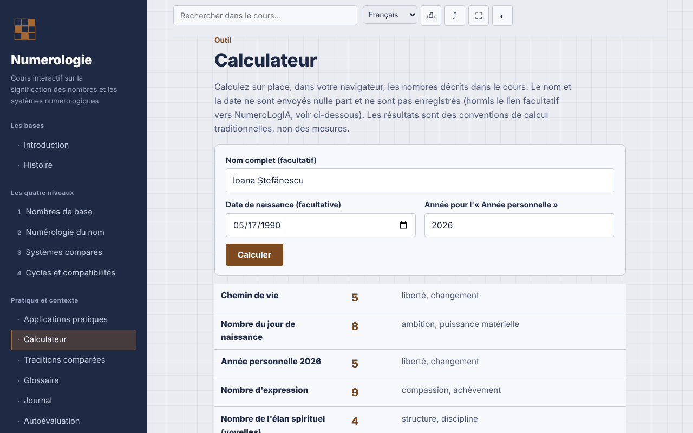

# Numérologie — cours interactif

[English](README.md) · [Română](README.ro.md) · **Français** · [Italiano](README.it.md) · [Español](README.es.md) · [Português](README.pt.md) · [Deutsch](README.de.md) · [Magyar](README.hu.md)

**Version :** 1.3.4 · **Dernière mise à jour :** 2026-10-22

Langues de l'interface : **Română, English, Français, Italiano, Español, Português (PT), Deutsch, Magyar**

Cours en roumain sur la numérologie (systèmes pythagoricien, chaldéen et kabbalistique), avec calculateur local, dans un seul fichier HTML.

**Application en ligne :** https://chiuta.github.io/Numerologie/

## De quoi s'agit-il

Un cours interactif sur la numérologie comme tradition symbolique : histoire, quatre niveaux (nombres de base, numérologie du nom, systèmes comparés, cycles et compatibilités), exercices, annexe comparative, glossaire, journal, autoévaluation et un calculateur qui applique les règles du cours. La numérologie est présentée comme tradition et divertissement, sans validation scientifique.

## Fonctionnalités

Sections : Introduction, Histoire, les quatre niveaux, Applications pratiques, Calculateur, Traditions comparées, Glossaire, Journal, Autoévaluation.

Vérifié dans le code et testé dans le navigateur :
- Calculateur local : Chemin de vie, Année personnelle, Nombre d'expression, Élan spirituel (voyelles) et Personnalité (consonnes). Table pythagoricienne A–Z (A,J,S=1 … I,R=9), nombres maîtres 11/22/33 conservés lors de la réduction de la date et du nom, Année personnelle réduite à 1–9. Les diacritiques roumains sont calculés comme la lettre de base (ă, â → A ; î → I ; ș, ț → S, T ; ainsi que les variantes à cédille) ; Y est une consonne. Le calculateur affiche les lettres et les valeurs utilisées et signale quand la méthode à réduction séparée du jour/mois/année donne un résultat différent.
- Le calculateur ajoute le Nombre du jour de naissance (le jour réduit, avec arrêt à 11, 22) et le Nombre de maturité (Chemin de vie + Expression, avec arrêt à 11, 22, 33) — conventions traditionnelles, non des mesures ; les boutons « Copier les résultats » et « Ajouter au journal » (uniquement les résultats numériques, sans nom ni date) restent dans la page.
- Le calculateur ajoute la valeur du nom dans le système chaldéen (table traditionnelle fondée sur le son, sans le chiffre 9 ; total composé → réduit), affichée à côté de l'Expression pythagoricienne, avec le détail des lettres.
- Mode sombre automatique (`prefers-color-scheme: dark` ; à l'impression, retour à la palette claire).
- Recherche insensible aux diacritiques ; lien direct vers les sections (`#calculator`, `#quiz`).
- Journal téléchargeable en `.txt` ; test de 10 questions avec ordre des réponses mélangé (Fisher–Yates).
- Impression (section courante), partage/copie du lien, plein écran, maintien de l'écran allumé (lorsque le navigateur les prend en charge).

## Mode d'emploi

1. Choisissez une section dans le menu (sur mobile, appuyez sur ☰).
2. Parcourez les niveaux et les exercices.
3. Dans « Calculateur », saisissez le nom et/ou la date de naissance (format de date du sélecteur ou `jour.mois.année`), vérifiez l'année pour l'Année personnelle et appuyez sur « Calculer ».
4. Notez vos observations dans le « Journal » et téléchargez-les en `.txt` avant de fermer la page.
5. Faites l'« Autoévaluation » ; « Refaire le test » mélange les réponses.

## Confidentialité et réseau

- Stockage : n'utilise ni `localStorage`, ni `sessionStorage`, ni IndexedDB, ni cookies. Le nom et la date saisis dans le calculateur restent dans la page et ne sont ni envoyés ni enregistrés.
- Réseau : aucune requête externe (ni polices, ni scripts, ni images, ni outils d'analyse). La CSP `default-src 'none'` bloque les connexions. Il n'y a aucun lien externe.
- Permissions : ne demande rien au chargement ; lorsque vous appuyez sur les boutons, peuvent être utilisés le plein écran, le wake lock, le presse-papiers (copie du lien) et la vibration sur mobile pendant le test.

## Limites et avertissements

- La numérologie est une tradition symbolique, utilisée pour la réflexion et le divertissement. Il n'existe aucune preuve scientifique que le nom ou la date de naissance détermine le caractère, les relations ou le destin.
- Le contenu ne remplace pas un avis médical, psychologique, juridique ou financier ; ne prenez pas de décisions concernant la santé, l'argent, les relations ou l'emploi sur la base d'un calcul.
- Il n'existe pas de convention de calcul unique ; d'autres sources peuvent donner d'autres résultats (traitement du Y, des diacritiques, ordre de réduction).
- L'origine babylonienne du système chaldéen et le lien direct de Pythagore avec le système moderne sont des attributions traditionnelles, non des faits historiques confirmés ; la mention de praticiens roumains est informative, sans évaluation.

## Exécution en local / hors ligne

Téléchargez `index.html` et ouvrez-le dans le navigateur ; il fonctionne sans internet.

## Licence

MIT — voir le fichier LICENSE.

## Historique / Changelog

### 1.3.4 — 2026-10-22

fff-kit 1.1.4 : cibles tactiles et taille de texte minimale; cibles tactiles et texte corrigés.

### 1.3.3 — 2026-10-22
- fff-kit 1.1.2 : PBKDF2 à 600 000 itérations, protection anti-clickjacking

### 1.3.2 — 2026-10-22
- Les boîtes confirm()/prompt() du navigateur remplacées par des dialogues propres, traduits dans les 8 langues (vidage du journal, copie manuelle du lien et des résultats).

### 1.2.0 — 2026-10-19
- Lien facultatif « Analyse approfondie dans NumeroLogIA » (nouvel onglet, `rel="noopener noreferrer"`), uniquement sur clic explicite : le nom et la date de naissance apparaissent dans le fragment `#` de l'adresse de NumeroLogIA (ils ne sont pas envoyés sur le réseau, mais restent dans l'historique du navigateur) ; note visible à côté du lien. L'affirmation « ne sont envoyés nulle part » a été modifiée en conséquence.

### 1.1.0 — 2026-10-14
- Sauvegarde et étiquetage des données (fff-kit).

### 1.0.0 — 2026-10-12
- La version et la date de dernière mise à jour sont affichées dans l'application (pied de page).

### 11 octobre 2026 (tour 7)
- Nouveau : mode sombre (la palette utilisait `--ink` aussi comme fond ; les fonds fixes sont passés à `--navy`, et l'impression force la palette claire) ; testé avec axe-core sur les 13 sections, en schémas clair et sombre, à 1280 et 360 px.
- Nouveau : la valeur chaldéenne du nom dans le calculateur.
- Corrigé : ordre des titres dans « Applications pratiques » (h2 → h4 ; axe `heading-order`).

### 11 octobre 2026 (tour 6)
- Sécurité : CSP `script-src` par hachage sha256 du script unique, sans `'unsafe-inline'` pour les scripts.
- Ajouté : Nombre du jour de naissance et Nombre de maturité dans le calculateur ; copie des résultats et ajout au Journal.

### 11 octobre 2026
- Corrigé : la page a désormais un titre de niveau 1 dans la zone principale (sur mobile le menu latéral est masqué, donc le titre du menu ne comptait plus) ; le titre du menu est un élément décoratif de même apparence. 0 violation axe-core à 1280 et 360 px.
- Vérifié : le calculateur utilise l'année courante calculée dynamiquement (Année personnelle 2026 au 11.10.2026).

## Auteur

Alexio — Alexandru-Ionuț Chiuță, contact : alexio@trom.tf

## Résumé

Un cours monofichier, hors ligne, en roumain, sur la numérologie (traditions pythagoricienne, chaldéenne, kabbalistique) avec un calculateur local pour le chemin de vie, l'année personnelle et les nombres du nom (expression, élan spirituel, personnalité), gérant les nombres maîtres et les diacritiques roumains. Aucun stockage, aucune requête externe, aucune télémétrie. Présenté comme tradition et divertissement sans validation scientifique ; ne remplace pas un conseil professionnel. Licence : MIT (voir le fichier LICENSE).
