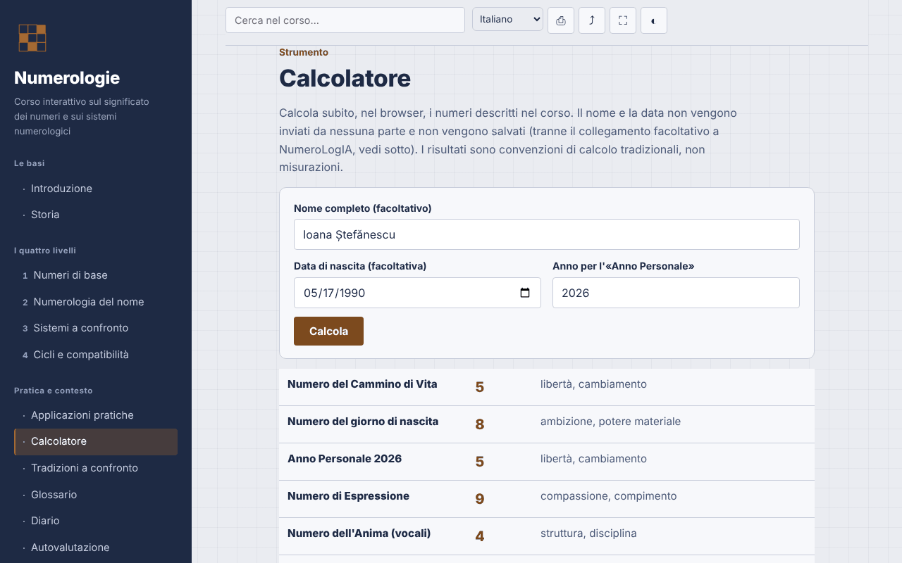

# Numerologia — corso interattivo

[English](README.md) · [Română](README.ro.md) · [Français](README.fr.md) · **Italiano** · [Español](README.es.md) · [Português](README.pt.md) · [Deutsch](README.de.md) · [Magyar](README.hu.md)

**Versione:** 1.3.4 · **Ultimo aggiornamento:** 2026-10-22

Lingue dell'interfaccia: **Română, English, Français, Italiano, Español, Português (PT), Deutsch, Magyar**

Corso in rumeno sulla numerologia (sistemi pitagorico, caldeo e cabalistico), con calcolatore locale, in un unico file HTML.

**Applicazione online:** https://chiuta.github.io/Numerologie/

## Che cos'è

Un corso interattivo sulla numerologia come tradizione simbolica: storia, quattro livelli (numeri di base, numerologia del nome, sistemi a confronto, cicli e compatibilità), esercizi, appendice comparativa, glossario, diario, autovalutazione e un calcolatore che applica le regole del corso. La numerologia è presentata come tradizione e intrattenimento, senza validazione scientifica.

## Funzionalità

Sezioni: Introduzione, Storia, i quattro livelli, Applicazioni pratiche, Calcolatore, Tradizioni a confronto, Glossario, Diario, Autovalutazione.

Verificato nel codice e testato nel browser:
- Calcolatore locale: Numero del Cammino di Vita, Anno Personale, Numero dell'Espressione, del Desiderio Interiore (vocali) e della Personalità (consonanti). Tabella pitagorica A–Z (A,J,S=1 … I,R=9), numeri maestri 11/22/33 mantenuti nella riduzione della data e del nome, Anno Personale ridotto a 1–9. I segni diacritici rumeni sono calcolati come la lettera base (ă, â → A; î → I; ș, ț → S, T; e le varianti con cediglia); Y è una consonante. Il calcolatore mostra le lettere e i valori usati e segnala quando il metodo con riduzione separata di giorno/mese/anno dà un risultato diverso.
- Il calcolatore aggiunge il Numero del Giorno di Nascita (il giorno ridotto, con arresto a 11, 22) e il Numero della Maturità (Cammino di Vita + Espressione, con arresto a 11, 22, 33) — convenzioni tradizionali, non misurazioni; i pulsanti «Copia i risultati» e «Aggiungi al diario» (solo i risultati numerici, senza nome né data) restano nella pagina.
- Il calcolatore aggiunge il valore del nome nel sistema caldeo (tabella tradizionale basata sul suono, senza la cifra 9; totale composto → ridotto), mostrato accanto all'Espressione pitagorica, con le lettere in dettaglio.
- Modalità scura automatica (`prefers-color-scheme: dark`; in stampa si torna alla palette chiara).
- Ricerca insensibile ai segni diacritici; link diretto alle sezioni (`#calculator`, `#quiz`).
- Diario scaricabile come `.txt`; test di 10 domande con ordine delle risposte mescolato (Fisher–Yates).
- Stampa (sezione corrente), condivisione/copia del link, schermo intero, schermo sempre attivo (dove il browser li supporta).

## Guida all'uso

1. Scegli una sezione dal menu (su mobile tocca ☰).
2. Percorri i livelli e gli esercizi.
3. In «Calcolatore» scrivi il nome e/o la data di nascita (formato data dal selettore o `giorno.mese.anno`), controlla l'anno per l'Anno Personale e premi «Calcola».
4. Annota le osservazioni nel «Diario» e scaricale come `.txt` prima di chiudere la pagina.
5. Svolgi l'«Autovalutazione»; «Ripeti il test» mescola le risposte.

## Privacy e rete

- Archiviazione: non usa `localStorage`, `sessionStorage`, IndexedDB né cookie. Il nome e la data inseriti nel calcolatore restano nella pagina e non vengono inviati né salvati.
- Rete: nessuna richiesta esterna (niente font, script, immagini, strumenti di analisi). La CSP `default-src 'none'` blocca le connessioni. Non ci sono link esterni.
- Permessi: non chiede nulla al caricamento; alla pressione dei pulsanti possono essere usati schermo intero, wake lock, appunti (copia del link) e vibrazione su mobile durante il test.

## Limiti e avvertenze

- La numerologia è una tradizione simbolica, usata per riflessione e intrattenimento. Non esistono prove scientifiche che il nome o la data di nascita determinino il carattere, le relazioni o il destino.
- Il contenuto non sostituisce il parere medico, psicologico, legale o finanziario; non prendere decisioni su salute, denaro, relazioni o impiego sulla base di un calcolo.
- Non esiste una convenzione di calcolo unica; altre fonti possono dare risultati diversi (trattamento della Y, dei segni diacritici, ordine di riduzione).
- L'origine babilonese del sistema caldeo e il legame diretto di Pitagora con il sistema moderno sono attribuzioni tradizionali, non fatti storici confermati; la menzione di praticanti rumeni è a titolo informativo, senza valutazione.

## Esecuzione in locale / offline

Scarica `index.html` e aprilo nel browser; funziona senza internet.

## Licenza

MIT — vedi il file LICENSE.

## Cronologia / Changelog

### 1.3.4 — 2026-10-22

fff-kit 1.1.4: target touch e dimensione minima del testo; target touch e testo corretti.

### 1.3.3 — 2026-10-22
- fff-kit 1.1.2: PBKDF2 con 600.000 iterazioni, protezione anti-clickjacking

### 1.3.2 — 2026-10-22
- Le finestre confirm()/prompt() del browser sostituite da finestre di dialogo proprie, tradotte nelle 8 lingue (svuotamento del diario, copia manuale del link e dei risultati).

### 1.2.0 — 2026-10-19
- Link facoltativo «Analisi estesa in NumeroLogIA» (nuova scheda, `rel="noopener noreferrer"`), solo con clic esplicito: il nome e la data di nascita compaiono nel frammento `#` dell'indirizzo di NumeroLogIA (non vengono inviati in rete, ma restano nella cronologia del browser); nota visibile accanto al link. L'affermazione «non vengono inviati da nessuna parte» è stata modificata di conseguenza.

### 1.1.0 — 2026-10-14
- Copia di riserva ed etichettatura dei dati (fff-kit).

### 1.0.0 — 2026-10-12
- La versione e la data dell'ultimo aggiornamento sono mostrate nell'applicazione (piè di pagina).

### 11 ottobre 2026 (giro 7)
- Novità: modalità scura (la palette usava `--ink` anche come sfondo; gli sfondi fissi sono passati a `--navy` e la stampa forza la palette chiara); testata con axe-core su tutte le 13 sezioni, negli schemi chiaro e scuro, a 1280 e 360 px.
- Novità: il valore caldeo del nome nel calcolatore.
- Corretto: ordine dei titoli in «Applicazioni pratiche» (h2 → h4; axe `heading-order`).

### 11 ottobre 2026 (giro 6)
- Sicurezza: CSP `script-src` tramite hash sha256 dell'unico script, senza `'unsafe-inline'` per gli script.
- Aggiunto: Numero del Giorno di Nascita e Numero della Maturità nel calcolatore; copia dei risultati e aggiunta al Diario.

### 11 ottobre 2026
- Corretto: la pagina ha ora un titolo di livello 1 nell'area principale (su mobile il menu laterale è nascosto, quindi il titolo nel menu non contava più); il titolo nel menu è un elemento decorativo con lo stesso aspetto. 0 violazioni axe-core a 1280 e 360 px.
- Verificato: il calcolatore usa l'anno corrente calcolato dinamicamente (Anno Personale 2026 all'11.10.2026).

## Autore

Alexio — Alexandru-Ionuț Chiuță, contatto: alexio@trom.tf

## Riepilogo

Un corso in un unico file, offline, in rumeno, sulla numerologia (tradizioni pitagorica, caldea, cabalistica) con un calcolatore locale per il cammino di vita, l'anno personale e i numeri del nome (espressione, desiderio interiore, personalità), che gestisce i numeri maestri e i segni diacritici rumeni. Nessuna archiviazione, nessuna richiesta esterna, nessuna telemetria. Presentato come tradizione e intrattenimento senza validazione scientifica; non sostituisce una consulenza professionale. Licenza: MIT (vedi il file LICENSE).
