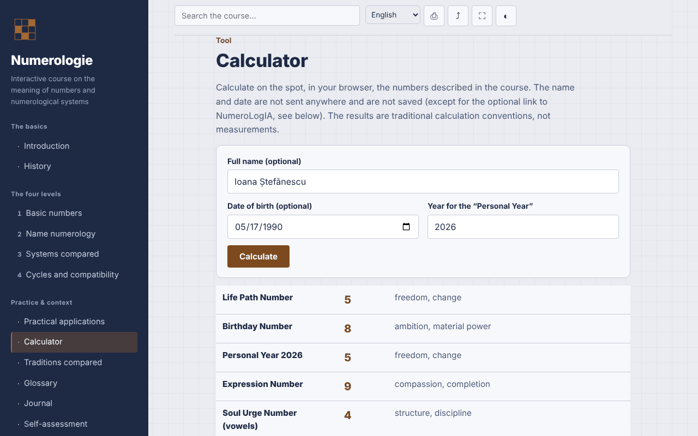

# Numerology — interactive course

**English** · [Română](README.ro.md) · [Français](README.fr.md) · [Italiano](README.it.md) · [Español](README.es.md) · [Português](README.pt.md) · [Deutsch](README.de.md) · [Magyar](README.hu.md)

**Version:** 2.0.0 · **Last updated:** 2026-10-26

Interface languages: **Română, English, Français, Italiano, Español, Português (PT), Deutsch, Magyar**

A course in Romanian on numerology (Pythagorean, Chaldean and Kabbalistic systems), with a local calculator, in a single HTML file.

**Live app:** https://chiuta.github.io/Numerologie/

## What it is

An interactive course on numerology as a symbolic tradition: history, four levels (core numbers, name numerology, systems compared, cycles and compatibilities), exercises, a comparative appendix, glossary, journal, self-assessment and a calculator that applies the rules from the course. Numerology is presented as tradition and entertainment, with no scientific validation.

## Features

Sections: Introduction, History, the four levels, Practical applications, Calculator, Traditions compared, Glossary, Journal, Self-assessment.

Verified in the code and tested in the browser:
- Local calculator: Life Path Number, Personal Year, Expression Number, Soul Urge (vowels) and Personality (consonants). Pythagorean A–Z table (A,J,S=1 … I,R=9), master numbers 11/22/33 kept when reducing the date and the name, Personal Year reduced to 1–9. Romanian diacritics are calculated as the base letter (ă, â → A; î → I; ș, ț → S, T; and the cedilla variants); Y is a consonant. The calculator shows the letters and values used and flags when the method with separate reduction of day/month/year gives a different result.
- The calculator adds the Birthday Number (the day reduced, stopping at 11, 22) and the Maturity Number (Life Path + Expression, stopping at 11, 22, 33) — traditional conventions, not measurements; the "Copy results" and "Add to journal" buttons (numerical results only, without name or date) stay on the page.
- The calculator adds the value of the name in the Chaldean system (traditional sound-based table, without the digit 9; compound total → reduced), shown alongside the Pythagorean Expression, with the letters detailed.
- Automatic dark mode (`prefers-color-scheme: dark`; when printing, it reverts to the light palette).
- Diacritics-insensitive search; direct link to sections (`#calculator`, `#quiz`).
- Journal downloadable as `.txt`; 10-question quiz with shuffled answer order (Fisher–Yates).
- Printing (current section), sharing/copying the link, full screen, keeping the screen awake (where the browser supports them).

## User guide

1. Choose a section from the menu (on mobile, tap ☰).
2. Go through the levels and the exercises.
3. In "Calculator" enter the name and/or the date of birth (date format from the selector or `day.month.year`), check the year for the Personal Year and press "Calculate".
4. Write your observations in the "Journal" and download them as `.txt` before closing the page.
5. Take the "Self-assessment"; "Retake the test" shuffles the answers.

## Privacy and network

- Storage: it does not use `localStorage`, `sessionStorage`, IndexedDB or cookies. The name and date entered in the calculator stay on the page and are neither sent nor saved.
- Network: no external requests (no fonts, scripts, images, analytics). CSP `default-src 'none'` blocks connections. There are no external links.
- Permissions: it asks for nothing on load; when you press buttons, full screen, wake lock, clipboard (link copying) and vibration on mobile during the quiz may be used.

## Limits and warnings

- Numerology is a symbolic tradition, used for reflection and entertainment. There is no scientific evidence that name or date of birth determines character, relationships or destiny.
- The content does not replace medical, psychological, legal or financial advice; do not make decisions about health, money, relationships or employment on the basis of a calculation.
- There is no single calculation convention; other sources may give different results (treatment of Y, of diacritics, order of reduction).
- The Babylonian origin of the Chaldean system and Pythagoras's direct connection to the modern system are traditional attributions, not confirmed historical facts; the mention of Romanian practitioners is informative, without evaluation.

## Running locally / offline

Download `index.html` and open it in the browser; it works without internet.

## License

MIT — see the LICENSE file.

## History / Changelog

### 1.3.6 — 2026-10-23

Audit: in the calculator, a name with no vowels (or no consonants) showed the raw key "m0" as the meaning of the Soul Urge / Personality number 0; it now shows a translated note in all 8 languages (machine translation, not native-checked).

### 1.3.4 — 2026-10-22

fff-kit 1.1.4: touch targets and minimum text size; touch targets and text size corrected.

### 1.3.3 — 2026-10-22
- fff-kit 1.1.2: PBKDF2 600,000 iterations, anti-clickjacking protection

### 1.3.2 — 2026-10-22
- Native browser confirm()/prompt() boxes replaced by own dialogs translated into the 8 languages (clearing the journal, manual copy of the link and of results).

### 1.2.0 — 2026-10-19
- Optional link "Extended analysis in NumeroLogIA" (new tab, `rel="noopener noreferrer"`), only on an explicit click: the name and date of birth appear in the `#` fragment of the NumeroLogIA address (they are not sent over the network, but remain in the browser history); a visible note next to the link. The statement "not sent anywhere" was amended accordingly.

### 1.1.0 — 2026-10-14
- Backup and data labelling (fff-kit).

### 1.0.0 — 2026-10-12
- The version and the date of the last update are shown in the app (footer).

### 11 October 2026 (round 7)
- New: dark mode (the palette used `--ink` also as a background; fixed backgrounds moved to `--navy`, and printing forces the light palette); tested with axe-core on all 13 sections, in light and dark schemes, at 1280 and 360 px.
- New: the Chaldean value of the name in the calculator.
- Fixed: heading order in "Practical applications" (h2 → h4; axe `heading-order`).

### 11 October 2026 (round 6)
- Security: CSP `script-src` by sha256 hash of the single script, without `'unsafe-inline'` for scripts.
- Added: Birthday Number and Maturity Number in the calculator; copying results and adding them to the Journal.

### 11 October 2026
- Fixed: the page now has a level-1 heading in the main area (on mobile the side menu is hidden, so the heading in the menu no longer counted); the heading in the menu is a decorative element with the same look. 0 axe-core violations at 1280 and 360 px.
- Verified: the calculator uses the current year computed dynamically (Personal Year 2026 on 11.10.2026).

## Author

Alexio — Alexandru-Ionuț Chiuță, contact: alexio@trom.tf

## Summary

A single-file, offline course in Romanian on numerology (Pythagorean, Chaldean, Kabbalistic traditions) with a local calculator for life path, personal year and name numbers (expression, soul urge, personality), handling master numbers and Romanian diacritics. No storage, no external requests, no telemetry. Presented as tradition and entertainment with no scientific validation; not a substitute for professional advice. License: MIT (see the LICENSE file).
