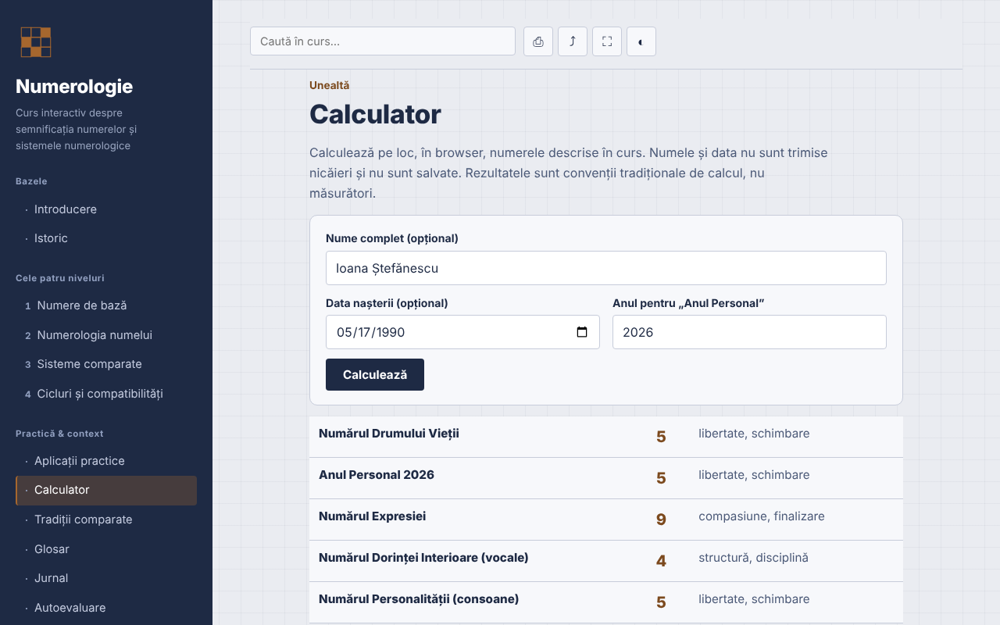

# Numerologia — curso interativo

[English](README.md) · [Română](README.ro.md) · [Français](README.fr.md) · [Italiano](README.it.md) · [Español](README.es.md) · **Português** · [Deutsch](README.de.md) · [Magyar](README.hu.md)

**Versão:** 1.3.0 · **Última atualização:** 2026-10-19

Idiomas da interface: **Română, English, Français, Italiano, Español, Português (PT), Deutsch, Magyar**

Curso em romeno sobre numerologia (sistemas pitagórico, caldeu e cabalístico), com calculadora local, num único ficheiro HTML.

**Aplicação online:** https://chiuta.github.io/Numerologie/

## O que é

Um curso interativo sobre numerologia como tradição simbólica: história, quatro níveis (números de base, numerologia do nome, sistemas comparados, ciclos e compatibilidades), exercícios, anexo comparativo, glossário, diário, autoavaliação e uma calculadora que aplica as regras do curso. A numerologia é apresentada como tradição e entretenimento, sem validação científica.

## Funcionalidades

Secções: Introdução, História, os quatro níveis, Aplicações práticas, Calculadora, Tradições comparadas, Glossário, Diário, Autoavaliação.

Verificado no código e testado no navegador:
- Calculadora local: Número do Caminho de Vida, Ano Pessoal, Número da Expressão, do Desejo Interior (vogais) e da Personalidade (consoantes). Tabela pitagórica A–Z (A,J,S=1 … I,R=9), números mestres 11/22/33 mantidos na redução da data e do nome, Ano Pessoal reduzido a 1–9. Os sinais diacríticos romenos são calculados como a letra de base (ă, â → A; î → I; ș, ț → S, T; e as variantes com cedilha); o Y é consoante. A calculadora mostra as letras e os valores utilizados e assinala quando o método com redução separada do dia/mês/ano dá um resultado diferente.
- A calculadora acrescenta o Número do Dia de Nascimento (o dia reduzido, com paragem em 11, 22) e o Número da Maturidade (Caminho de Vida + Expressão, com paragem em 11, 22, 33) — convenções tradicionais, não medições; os botões «Copiar resultados» e «Adicionar ao diário» (apenas os resultados numéricos, sem nome nem data) permanecem na página.
- A calculadora acrescenta o valor do nome no sistema caldeu (tabela tradicional baseada no som, sem o algarismo 9; total composto → reduzido), apresentado junto da Expressão pitagórica, com as letras detalhadas.
- Modo escuro automático (`prefers-color-scheme: dark`; na impressão volta-se à paleta clara).
- Pesquisa insensível aos sinais diacríticos; ligação direta às secções (`#calculator`, `#quiz`).
- Diário descarregável como `.txt`; teste de 10 perguntas com a ordem das respostas misturada (Fisher–Yates).
- Impressão (secção atual), partilha/cópia da ligação, ecrã inteiro, manter o ecrã ativo (onde o navegador o permita).

## Manual de utilização

1. Escolha uma secção no menu (no telemóvel, toque em ☰).
2. Percorra os níveis e os exercícios.
3. Em «Calculadora» escreva o nome e/ou a data de nascimento (formato de data do seletor ou `dia.mês.ano`), verifique o ano para o Ano Pessoal e prima «Calcular».
4. Anote as observações no «Diário» e descarregue-as como `.txt` antes de fechar a página.
5. Resolva a «Autoavaliação»; «Repetir o teste» mistura as respostas.

## Privacidade e rede

- Armazenamento: não utiliza `localStorage`, `sessionStorage`, IndexedDB nem cookies. O nome e a data introduzidos na calculadora ficam na página e não são enviados nem guardados.
- Rede: nenhum pedido externo (sem tipos de letra, scripts, imagens, ferramentas de análise). A CSP `default-src 'none'` bloqueia as ligações. Não existem ligações externas.
- Permissões: não pede nada ao carregar; ao premir os botões, podem ser utilizados ecrã inteiro, wake lock, área de transferência (cópia da ligação) e vibração no telemóvel durante o teste.

## Limites e avisos

- A numerologia é uma tradição simbólica, usada para reflexão e entretenimento. Não existem provas científicas de que o nome ou a data de nascimento determinem o caráter, as relações ou o destino.
- O conteúdo não substitui aconselhamento médico, psicológico, jurídico ou financeiro; não tome decisões sobre saúde, dinheiro, relações ou emprego com base num cálculo.
- Não existe uma convenção de cálculo única; outras fontes podem dar resultados diferentes (tratamento do Y, dos sinais diacríticos, ordem da redução).
- A origem babilónica do sistema caldeu e a ligação direta de Pitágoras ao sistema moderno são atribuições tradicionais, não factos históricos confirmados; a menção a praticantes romenos é informativa, sem avaliação.

## Execução local / offline

Descarregue `index.html` e abra-o no navegador; funciona sem internet.

## Licença

MIT — veja o ficheiro LICENSE.

## Histórico / Changelog

### 1.2.0 — 2026-10-19
- Ligação opcional «Análise alargada no NumeroLogIA» (novo separador, `rel="noopener noreferrer"`), apenas com clique explícito: o nome e a data de nascimento aparecem no fragmento `#` do endereço do NumeroLogIA (não são enviados pela rede, mas ficam no histórico do navegador); nota visível junto da ligação. A afirmação «não são enviados para lado nenhum» foi alterada em conformidade.

### 1.1.0 — 2026-10-14
- Cópia de segurança e etiquetagem de dados (fff-kit).

### 1.0.0 — 2026-10-12
- A versão e a data da última atualização são apresentadas na aplicação (rodapé).

### 11 de outubro de 2026 (ronda 7)
- Novo: modo escuro (a paleta usava `--ink` também como fundo; os fundos fixos passaram para `--navy` e a impressão força a paleta clara); testado com axe-core em todas as 13 secções, nos esquemas claro e escuro, a 1280 e 360 px.
- Novo: o valor caldeu do nome na calculadora.
- Corrigido: ordem dos títulos em «Aplicações práticas» (h2 → h4; axe `heading-order`).

### 11 de outubro de 2026 (ronda 6)
- Segurança: CSP `script-src` por hash sha256 do único script, sem `'unsafe-inline'` para scripts.
- Adicionado: Número do Dia de Nascimento e Número da Maturidade na calculadora; cópia dos resultados e adição ao Diário.

### 11 de outubro de 2026
- Corrigido: a página tem agora um título de nível 1 na área principal (no telemóvel o menu lateral está oculto, pelo que o título do menu deixava de contar); o título do menu é um elemento decorativo com o mesmo aspeto. 0 violações axe-core a 1280 e 360 px.
- Verificado: a calculadora usa o ano corrente calculado dinamicamente (Ano Pessoal 2026 a 11.10.2026).

## Autor

Alexio — Alexandru-Ionuț Chiuță, contacto: alexio@trom.tf

## Resumo

Um curso de ficheiro único, offline, em romeno, sobre numerologia (tradições pitagórica, caldeia, cabalística) com uma calculadora local para o caminho de vida, o ano pessoal e os números do nome (expressão, desejo interior, personalidade), que trata os números mestres e os sinais diacríticos romenos. Sem armazenamento, sem pedidos externos, sem telemetria. Apresentado como tradição e entretenimento sem validação científica; não substitui aconselhamento profissional. Licença: MIT (veja o ficheiro LICENSE).
