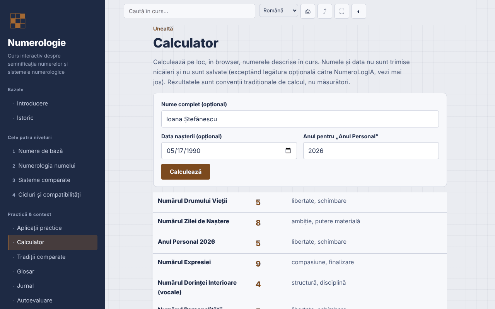

# Numerologie — curs interactiv

[English](README.md) · **Română** · [Français](README.fr.md) · [Italiano](README.it.md) · [Español](README.es.md) · [Português](README.pt.md) · [Deutsch](README.de.md) · [Magyar](README.hu.md)

**Versiune:** 1.3.6 · **Ultima actualizare:** 2026-10-23

Limbile interfeței: **Română, English, Français, Italiano, Español, Português (PT), Deutsch, Magyar**

Curs în română despre numerologie (sisteme pitagoreic, caldeean, kabbalistic), cu calculator local, într-un singur fișier HTML.

**Live:** https://chiuta.github.io/Numerologie/

## Ce este

Un curs interactiv despre numerologie ca tradiție simbolică: istoric, patru niveluri (numere de bază, numerologia numelui, sisteme comparate, cicluri și compatibilități), exerciții, anexă comparativă, glosar, jurnal, autoevaluare și un calculator care aplică regulile din curs. Numerologia este prezentată ca tradiție și divertisment, fără validare științifică.

## Funcții

Secțiuni: Introducere, Istoric, cele patru niveluri, Aplicații practice, Calculator, Tradiții comparate, Glosar, Jurnal, Autoevaluare.

Verificate în cod și testate în browser:
- Calculator local: Numărul Drumului Vieții, Anul Personal, Numărul Expresiei, al Dorinței Interioare (vocale) și al Personalității (consoane). Tabel pitagoreic A–Z (A,J,S=1 … I,R=9), numere maestre 11/22/33 păstrate la reducerea datei și a numelui, Anul Personal redus la 1–9. Diacriticele românești se calculează ca litera de bază (ă, â → A; î → I; ș, ț → S, T; și variantele cu sedilă); Y este consoană. Calculatorul arată literele și valorile folosite și semnalează când metoda cu reducere separată a zilei/lunii/anului dă alt rezultat.
- Calculatorul adaugă Numărul Zilei de Naștere (ziua redusă cu oprire la 11, 22) și Numărul Maturității (Drumul Vieții + Expresia, cu oprire la 11, 22, 33) — convenții tradiționale, nu măsurători; butoanele „Copiază rezultatele” și „Adaugă în jurnal” (doar rezultatele numerice, fără nume sau dată) rămân în pagină.
- Calculatorul adaugă valoarea numelui în sistemul caldeean (tabel tradițional bazat pe sunet, fără cifra 9; total compus → redus), afișată alături de Expresia pitagoreică, cu literele detaliate.
- Mod întunecat automat (`prefers-color-scheme: dark`; la tipărire se revine la paleta deschisă).
- Căutare fără sensibilitate la diacritice; link direct la secțiuni (`#calculator`, `#quiz`).
- Jurnal descărcabil `.txt`; test de 10 întrebări cu ordinea răspunsurilor amestecată (Fisher–Yates).
- Printare (secțiunea curentă), distribuire/copiere link, ecran complet, păstrare ecran activ (unde browserul le acceptă).

## Manual de utilizare

1. Alege o secțiune din meniu (pe mobil apasă ☰).
2. Parcurge nivelurile și exercițiile.
3. În „Calculator” scrie numele și/sau data nașterii (format de dată din selector sau `zi.lună.an`), verifică anul pentru Anul Personal și apasă „Calculează”.
4. Notează observațiile în „Jurnal” și descarcă-le ca `.txt` înainte de a închide pagina.
5. Rezolvă „Autoevaluarea”; „Reia testul” amestecă răspunsurile.

## Confidențialitate și rețea

- Stocare: nu folosește `localStorage`, `sessionStorage`, IndexedDB sau cookie-uri. Numele și data introduse în calculator rămân în pagină și nu sunt trimise sau salvate.
- Rețea: nicio cerere externă (fără fonturi, scripturi, imagini, analitice). CSP `default-src 'none'` blochează conexiunile. Nu există linkuri externe.
- Permisiuni: nu cere nimic la încărcare; la apăsarea butoanelor pot fi folosite ecran complet, wake lock, clipboard (copiere link) și vibrații pe mobil la test.

## Limite și avertismente

- Numerologia este o tradiție simbolică, folosită ca reflecție și divertisment. Nu există dovezi științifice că numele sau data nașterii determină caracterul, relațiile sau destinul.
- Conținutul nu înlocuiește sfatul medical, psihologic, juridic sau financiar; nu lua decizii despre sănătate, bani, relații sau angajări pe baza unui calcul.
- Nu există o convenție unică de calcul; alte surse pot da alte rezultate (tratarea lui Y, a diacriticelor, ordinea reducerii).
- Originea babiloniană a sistemului caldeean și legătura directă a lui Pitagora cu sistemul modern sunt atribuiri tradiționale, nu fapte istorice confirmate; menționarea unor practicieni români este informativă, fără evaluare.

## Rulare locală / offline

Descarcă `index.html` și deschide-l în browser; funcționează fără internet.

## Licență

MIT — vezi fișierul LICENSE.

## Istoric / Changelog

### 1.3.6 — 2026-10-23

Audit: în calculator, un nume fără vocale (sau fără consoane) afișa cheia brută „m0” ca sens al numărului 0; acum apare o notă tradusă în cele 8 limbi (traducere automată, neverificată de vorbitori nativi).

### 1.3.4 — 2026-10-22

fff-kit 1.1.4: ținte tactile și text minim; ținte tactile/text corectate.

### 1.3.3 — 2026-10-22
- fff-kit 1.1.2: PBKDF2 600 000 iterații, protecție anti-clickjacking

### 1.3.2 — 2026-10-22
- Casetele confirm()/prompt() ale browserului înlocuite cu dialoguri proprii, traduse în cele 8 limbi (golirea jurnalului, copierea manuală a linkului și a rezultatelor).

### 1.2.0 — 2026-10-19
- Link opțional „Analiză extinsă în NumeroLogIA” (filă nouă, `rel="noopener noreferrer"`), doar la click explicit: numele și data nașterii apar în fragmentul `#` al adresei NumeroLogIA (nu se trimit pe rețea, dar rămân în istoricul browserului); notă vizibilă lângă link. Afirmația „nu sunt trimise nicăieri” amendată în consecință.

### 1.1.0 — 2026-10-14
- Copie de rezervă și etichetare date (fff-kit).

### 1.0.0 — 2026-10-12
- Versiunea și data ultimei actualizări sunt afișate în aplicație (subsol).

### 11 octombrie 2026 (runda 7)
- Nou: mod întunecat (paleta folosea `--ink` și ca fundal; fundalurile fixe au trecut pe `--navy`, iar tipărirea forțează paleta deschisă); testat cu axe-core pe toate cele 13 secțiuni, în schemele deschisă și întunecată, la 1280 și 360 px.
- Nou: valoarea caldeeană a numelui în calculator.
- Reparat: ordinea titlurilor în „Aplicații practice” (h2 → h4; axe `heading-order`).

### 11 octombrie 2026 (runda 6)
- Securitate: CSP `script-src` pe hash sha256 al scriptului unic, fără `'unsafe-inline'` pentru scripturi.
- Adăugat: Numărul Zilei de Naștere și Numărul Maturității în calculator; copiere rezultate și adăugare în Jurnal.

### 11 octombrie 2026
- Reparat: pagina are acum un titlu de nivel 1 în zona principală (pe mobil meniul lateral este ascuns, deci titlul din meniu nu mai conta); titlul din meniu este un element decorativ cu același aspect. 0 violări axe-core la 1280 și 360 px.
- Verificat: calculatorul folosește anul curent calculat dinamic (Anul Personal 2026 la 11.10.2026).

## Autor

Alexio — Alexandru-Ionuț Chiuță, contact: alexio@trom.tf

## Rezumat

Un curs offline într-un singur fișier, în limba română, despre numerologie (tradițiile pitagoreică, caldeeană, cabalistică), cu un calculator local pentru calea vieții, anul personal și numerele numelui (expresie, impuls sufletesc, personalitate), care tratează numerele-maestru și diacriticele românești. Fără stocare, fără cereri externe, fără telemetrie. Prezentată ca tradiție și divertisment, fără validare științifică; nu înlocuiește sfatul profesional. Licență: MIT (vezi fișierul LICENSE).
